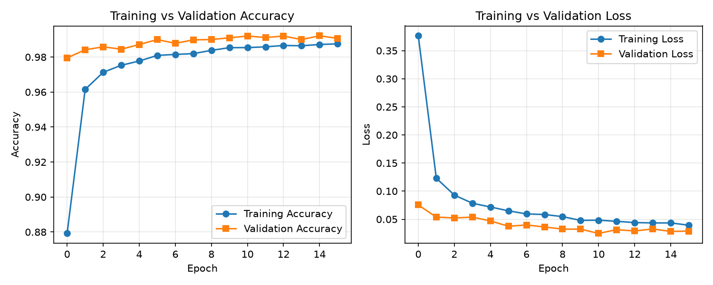
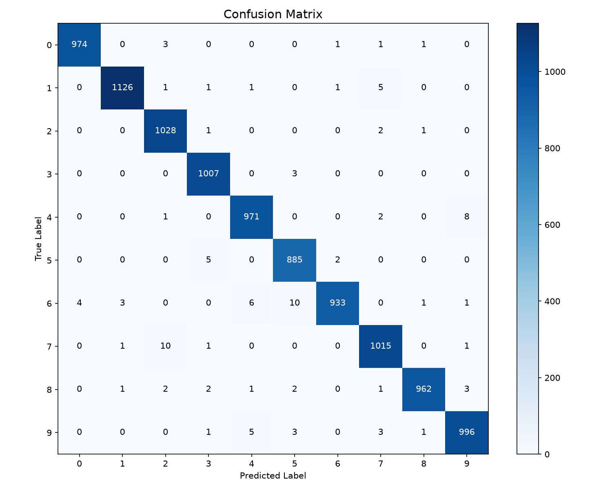

# Model Evaluation Report

## Overview

This report shows the results from evaluating the trained CNN model on the MNIST test set (10,000 images). All metrics were computed from actual model predictions, nothing is hardcoded.

## Test Results

| Metric | Score |
|--------|-------|
| **Test Accuracy** | 98.97% |
| **Test Loss** | 0.0365 |
| **Precision** (weighted) | 98.97% |
| **Recall** (weighted) | 98.97% |
| **F1-Score** (weighted) | 98.97% |

## Per-Digit Classification Report

| Digit | Precision | Recall | F1-Score | Test Samples |
|-------|-----------|--------|----------|--------------|
| 0 | 0.9959 | 0.9939 | 0.9949 | 980 |
| 1 | 0.9956 | 0.9921 | 0.9938 | 1135 |
| 2 | 0.9837 | 0.9961 | 0.9899 | 1032 |
| 3 | 0.9892 | 0.9970 | 0.9931 | 1010 |
| 4 | 0.9868 | 0.9888 | 0.9878 | 982 |
| 5 | 0.9801 | 0.9922 | 0.9861 | 892 |
| 6 | 0.9957 | 0.9739 | 0.9847 | 958 |
| 7 | 0.9864 | 0.9874 | 0.9869 | 1028 |
| 8 | 0.9959 | 0.9877 | 0.9918 | 974 |
| 9 | 0.9871 | 0.9871 | 0.9871 | 1009 |
| **Overall** | **0.9897** | **0.9897** | **0.9897** | **10000** |

The model performs well across all digits. Digit 6 has the lowest recall (0.9739) — it occasionally gets misclassified, probably because handwritten 6s can look similar to 0s or 5s depending on how they're drawn.

## Training Curves

The plots below show how accuracy and loss changed during training. The model converges pretty quickly and the gap between training and validation stays small, which means it's not overfitting too badly.

## Confusion Matrix

This shows how many times each digit was predicted correctly vs confused with another digit. The diagonal (dark blue) represents correct predictions. Off-diagonal values are misclassifications.

Most errors are very few in number (single digits out of ~1000 test samples per class), which shows the model is pretty reliable.

## How these were generated

All results come from running `python evaluate.py` after training. The script:
1. Loads the trained model from `models/mnist_model.keras`
2. Runs it on the 10,000 test images (which the model never saw during training)
3. Computes accuracy, precision, recall, and F1 using scikit-learn
4. Generates the confusion matrix and training plots using matplotlib

Nothing was cherry-picked or adjusted after the fact.
